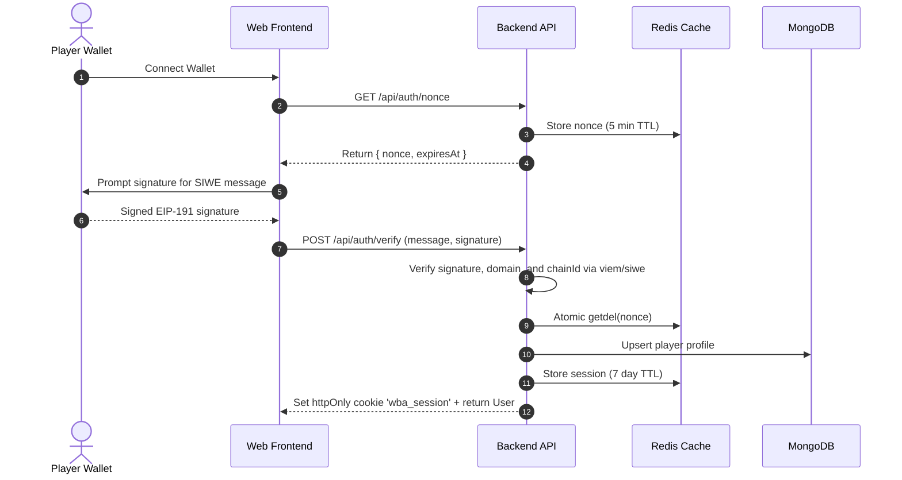

# Web3 Battle Arena — Complete Backend

Real-time two-player Battleship with Ethereum wallet authentication (SIWE), cryptographic fleet commit-reveal, replay-verifiable canonical match records, Redis leaderboards, achievement badges (ERC-1155), social features, simulated ARENA rewards ledger, and asynchronous blockchain recording (simulated local fallback & Sepolia testnet adapter).

Gameplay is strictly off-chain and real-time; verifiable match outcomes are recorded asynchronously to the blockchain without ever blocking a turn.

---

## 1. Project Overview & Architecture

Web3 Battle Arena backend consists of:

- **Game Engine (`@wba/engine`):** A pure, deterministic TypeScript Battleship engine managing rules, placement validation, shots, turn timeouts, forfeits, fleet commitment hashes, public view masking, and match replay verification.
- **Shared Package (`@wba/shared`):** Zod schemas, TypeScript types, and event definitions shared across backend and frontend clients.
- **Smart Contracts (`@wba/contracts`):** Solidity contracts built with OpenZeppelin:
  - `MatchRegistry.sol`: On-chain registry recording deterministic match IDs, winners, and Keccak-256 result hashes with access control and event emission.
  - `AchievementBadges.sol`: ERC-1155 contract awarding verifiable achievement badges.
- **Server Application (`@wba/server`):**
  - **REST API (Express):** Endpoints for SIWE authentication, player profiles, match replay & verification audits, leaderboards, friendships, invites, notifications, rewards ledger, and tournaments.
  - **Real-Time Multiplayer (Socket.IO):** Authenticated socket connections, public matchmaking queue, private room codes, server-authoritative timers (60s placement, 20s turn), disconnect grace periods (30s), spectators, and in-game chat.
  - **Data Persistence:** MongoDB via Mongoose with resilient in-memory fallbacks for offline test/development execution.
  - **Cache & Infrastructure:** Redis for single-use SIWE nonces, session invalidation, queue coordination, and sorted sets for real-time leaderboards.
  - **Workers & Background Jobs:** Post-match worker (BullMQ + direct in-process runner) for statistics, leaderboards, badge evaluations, simulated ARENA ledger, and blockchain recording.

---

## 2. Repository Structure

```text
web3-battle-arena/
├── apps/
│   └── server/
│       ├── src/
│       │   ├── app.ts                 # Express app configuration & middleware
│       │   ├── server.ts              # HTTP & Socket.IO server bootstrap
│       │   ├── config/env.ts          # Zod environment variable validation
│       │   ├── middleware/            # Auth, rate limiting, error handling, correlation ID
│       │   ├── models/                # Mongoose models (Player, Match, ChainLog, etc.)
│       │   ├── repositories/          # Data access repositories with memory fallbacks
│       │   ├── services/              # SIWE auth, redis, matchmaking, matchManager, chain
│       │   ├── modules/               # REST routers (auth, players, matches, social, etc.)
│       │   ├── sockets/               # Authenticated Socket.IO server & event handlers
│       │   └── workers/               # Post-match processor & BullMQ worker
│       └── tests/                     # Vitest automated integration test suite
├── packages/
│   ├── engine/                        # Pure Battleship game engine & tests
│   ├── shared/                        # Zod schemas, socket events, and shared types
│   └── contracts/                     # Solidity contracts, Hardhat tests, and artifacts
├── docker-compose.yml                 # Local MongoDB 7.0 & Redis 7.2 alpine services
├── .env.example                       # Documented environment configuration keys
├── package.json                       # Monorepo workspaces & root scripts
├── tsconfig.base.json                 # Shared TypeScript base configuration
└── README.md
```

---

## 3. Prerequisites

- **Node.js:** `>= 20.0.0`
- **npm:** `>= 10.0.0`
- **Docker & Docker Compose:** Optional for running local MongoDB & Redis instances. (The test suite and development server include seamless local fallbacks if Docker is not running).

---

## 4. Installation & Quick Start

```bash
# 1. Clone the repository and install all dependencies
npm install

# 2. Compile contracts, build all packages and typecheck
npm run build
npm run typecheck

# 3. Run all automated tests (94 tests across monorepo)
npm test

# 4. Verify formatting and linting
npm run lint
npm run format:check
```

---

## 5. Environment Setup

Copy `.env.example` to `.env`:

```bash
cp .env.example .env
```

Key environment settings:

| Variable                 | Description                                            | Default                              |
| ------------------------ | ------------------------------------------------------ | ------------------------------------ |
| `NODE_ENV`               | Environment mode (`development`, `test`, `production`) | `development`                        |
| `PORT`                   | API & Socket server port                               | `4000`                               |
| `API_ORIGIN`             | Server public origin                                   | `http://localhost:4000`              |
| `WEB_ORIGIN`             | Allowed client origin for CORS & cookies               | `http://localhost:3000`              |
| `MONGODB_URI`            | MongoDB connection URI                                 | `mongodb://localhost:27017/wba_game` |
| `REDIS_URL`              | Redis connection URL                                   | `redis://localhost:6379`             |
| `SESSION_SECRET`         | Secret used for session signing                        | (Configured dev default)             |
| `SIWE_DOMAIN`            | Expected SIWE domain                                   | `localhost:3000`                     |
| `SUPPORTED_CHAIN_ID`     | Supported network chain ID (Sepolia: `11155111`)       | `11155111`                           |
| `CHAIN_MODE`             | Blockchain recording mode: `simulated` or `testnet`    | `simulated`                          |
| `RPC_URL`                | Ethereum RPC provider URL                              | `https://rpc.sepolia.org`            |
| `RELAYER_PRIVATE_KEY`    | Relayer private key for testnet transactions           | `0x...`                              |
| `MATCH_REGISTRY_ADDRESS` | Deployed `MatchRegistry` contract address              | `0x...`                              |

---

## 6. Local Database Startup (Docker Compose)

To spin up local MongoDB and Redis instances:

```bash
docker compose up -d
```

Verify service status:

```bash
docker compose ps
```

---

## 7. Running the Server & Worker

Start the server in development mode with live watch:

```bash
npm run dev --workspace=@wba/server
```

Or build and run in production mode:

```bash
npm run build
npm start --workspace=@wba/server
```

To run the standalone post-match worker daemon:

```bash
npm run worker --workspace=@wba/server
```

---

## 8. Running Automated Tests

All tests execute without requiring pre-running database daemons or external blockchain networks:

```bash
# Run tests across all workspaces (engine, contracts, shared, server)
npm test

# Run contracts tests via Hardhat
npm test --workspace=@wba/contracts

# Run server unit & integration tests
npm test --workspace=@wba/server
```

---

## 9. REST API Documentation

All endpoints return a standardized JSON envelope: `{ success: boolean, data?: T, error?: { code, message, details } }`.

### Health & Readiness

- `GET /health`: Uptime and system timestamp.
- `GET /ready`: Connectivity status of MongoDB and Redis.

### Authentication (SIWE)

- `GET /api/auth/nonce`: Issues a single-use cryptographically secure alphanumeric nonce with 5-minute TTL.
- `POST /api/auth/verify`: Verifies SIWE message signature, consumes nonce atomically, sets `wba_session` cookie, and returns user session.
- `GET /api/auth/me`: Returns profile of the authenticated wallet (requires valid session).
- `POST /api/auth/logout`: Invalidates session in Redis and clears session cookie.

### Players

- `GET /api/players/:address`: Fetches public profile and game statistics.
- `PATCH /api/players/me`: Updates username and avatar for authenticated player.
- `GET /api/players/:address/matches`: Returns paginated match history for player.

### Matches & Replay Verification

- `GET /api/matches/:id`: Returns match state (viewer-filtered if active, public record if completed).
- `GET /api/matches/:id/replay`: Audits full shot log against revealed boards using pure engine scoring.
- `GET /api/matches/:id/verification`: Retrieves cryptographic verification status, canonical record, result hash, and chain status.
- `POST /api/matches/:id/reveal`: REST endpoint for submitting post-match reveal salt and board.

### Leaderboards

- `GET /api/leaderboards/points`: Highest total score leaderboard (with pagination).
- `GET /api/leaderboards/streak`: Best hit streak leaderboard.
- `GET /api/leaderboards/fastest_win`: Fewest shots to victory leaderboard.

### Social & Friends

- `GET /api/friends`: Returns friends list and pending friend requests.
- `POST /api/friends`: Sends a friend request to target wallet.
- `PATCH /api/friends/:id`: Accepts or rejects a friend request.
- `DELETE /api/friends/:address`: Removes a friend.
- `GET /api/invites`: Retrieves pending private room invitations.
- `POST /api/invites`: Sends match invitation to another player.
- `PATCH /api/invites/:id`: Accepts or declines match invite.

### Notifications

- `GET /api/notifications`: Retrieves notifications for authenticated player.
- `PATCH /api/notifications/:id`: Marks notification as read.

### Rewards & Badges

- `GET /api/rewards/me`: Returns simulated ARENA token balance and ledger transaction history.
- `GET /api/badges`: Catalog of all 5 achievement badges and token IDs.
- `GET /api/players/:address/badges`: Unlocked badges for a specific player address.

### Tournaments

- `GET /api/tournaments`: Lists tournaments (filter by `status=open` or `closed`).
- `GET /api/tournaments/:id`: Fetches tournament details and standings.
- `POST /api/tournaments`: Creates a new tournament window.

---

## 10. Real-Time Socket.IO Events

### Client-to-Server Events

- `queue:join`: Enters matchmaking queue (`{ mode?: 'ranked' | 'casual' }`).
- `queue:leave`: Leaves matchmaking queue.
- `room:create`: Creates a private game room with custom or random code.
- `room:join`: Joins a private game room with code (`{ roomCode: string }`).
- `placement:submit`: Submits fleet board and Keccak-256 commitment hash.
- `shot:fire`: Fires at a board cell (`{ matchId, coordinate: { x, y } }`).
- `reveal:submit`: Submits salt and board after match conclusion.
- `spectate:join`: Joins an active match as a spectator.
- `chat:send`: Sends an in-game chat message (`{ matchId, text }`).
- `invite:send`: Sends private game invite to a wallet address.

### Server-to-Client Events

- `match:found`: Fired when 2 players are paired (`{ matchId, roomCode, players, expiresAt }`).
- `match:start`: Fired when both placements are accepted (`{ matchId, currentTurn, turnDeadline }`).
- `shot:result`: Result of a shot (`shooter`, `coordinate`, `outcome`, `pointsAwarded`, `shooterScore`, `nextTurn`, `gameOver`).
- `turn:timer`: Periodic countdown for active turn (`secondsRemaining`, `deadline`).
- `match:end`: Match finished event with winner, forfeit status, and final clamped scores.
- `match:verified`: Verification status and Keccak-256 canonical result hash.
- `chat:message`: Broadcast chat message to room participants.
- `spectate:view`: Public viewer-filtered match state for spectators.

---

## 11. Sign-In with Ethereum (SIWE) Flow



---

## 12. Fleet Commit-Reveal & Replay Verification

1. **Commitment:** Prior to battle, each player creates a secret 32-byte salt and generates a Keccak-256 commitment:
   $$\text{commitment} = \text{keccak256}(\text{"WBA-FLEET-v1|ships=...|mines=...|salt="} \parallel \text{salt})$$
2. **Battle:** Gameplay proceeds with server-authoritative turns without either player seeing the opponent's hidden ships or mines.
3. **Reveal:** After the match, both players reveal their secret salt and ship/mine locations.
4. **Audit:** The engine recomputes the commitment hash. If valid, the complete shot log is replayed against the revealed boards from turn 0, recomputing all scores, streak bonuses, and the winner.
5. **Canonical Record & Result Hash:** The canonical match record (independent of database IDs or wall-clock timestamps) is hashed with Keccak-256 to produce the immutable `resultHash`.

---

## 13. Blockchain Recording Modes

### Simulated Mode (Default)

When `CHAIN_MODE=simulated`, the backend does not require external RPC endpoints or gas funds:

- Generates a deterministic simulated transaction hash: `0xsim_<keccak256_digest>`.
- Writes the transaction record to MongoDB `chain_log`.
- Updates the match record with status `recorded`.
- Idempotent: repeated calls safely return the existing transaction record without duplicate side-effects.

### Testnet Mode (Sepolia)

When `CHAIN_MODE=testnet` with valid RPC credentials:

- Uses `viem` with server-side relayer account.
- Invokes `MatchRegistry.recordMatch(bytes32 matchId, address winner, bytes32 resultHash)`.
- Awaits receipt confirmation and verifies `MatchRecorded` event emission.
- Persists transaction hash, block number, and execution status.

---

## 14. Smart Contract Deployment

To deploy contracts to Sepolia or a local Hardhat node:

```bash
# In packages/contracts
npx hardhat compile
npx hardhat test
```

Deployment script template:

```javascript
// packages/contracts/scripts/deploy.js
const { viem } = require('hardhat');

async function main() {
  const [deployer] = await viem.getWalletClients();
  const registry = await viem.deployContract('MatchRegistry', [
    deployer.account.address,
    deployer.account.address,
  ]);
  console.log('MatchRegistry deployed to:', registry.address);
}

main().catch(console.error);
```

---

## 15. End-to-End Demo Walkthrough

1. **Start Local Services:**
   ```bash
   docker compose up -d # (or run with built-in memory fallback)
   npm run dev --workspace=@wba/server
   ```
2. **Check System Health:**
   ```bash
   curl http://localhost:4000/health
   curl http://localhost:4000/ready
   ```
3. **Authenticate Two Wallets (SIWE):**
   - Request nonces: `GET /api/auth/nonce`
   - Sign SIWE message and verify: `POST /api/auth/verify`
4. **Enter Matchmaking Queue:**
   - Connect client 1 & client 2 over Socket.IO with session token.
   - Emit `queue:join` from both clients.
   - Server pairs players and emits `match:found`.
5. **Submit Fleet Placements:**
   - Both clients submit boards and Keccak-256 commitment hashes (`placement:submit`).
   - Server validates fleets and emits `match:start`.
6. **Play Game:**
   - Active player fires shots (`shot:fire`).
   - Sinking all 5 opponent ships finishes the match (`match:end`).
7. **Submit Reveals & Audit Replay:**
   - Both clients submit `reveal:submit`.
   - Server audits reveals against commitments and verifies replay scores (`match:verified`).
8. **Inspect Persisted Outcomes:**
   - Replay audit: `GET /api/matches/:id/replay`
   - Verification record: `GET /api/matches/:id/verification`
   - Updated leaderboards: `GET /api/leaderboards/points`
   - Unlocked achievement badges: `GET /api/players/:address/badges`
   - ARENA rewards balance: `GET /api/rewards/me`
